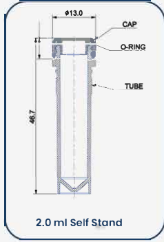

# Abdos

## Tubes

| Description | Image | PLR definition |
|-------------|-------|----------------|
| 2 mL self-standing, skirted screw-cap tube Part no.: P10235 [manufacturer website](https://www.abdoslifesciences.com/product/screw-cap-tubes/) [dimension source](https://www.abdoslifesciences.com/wp-content/uploads/2025/11/ABDOS-Screw-Cap-Tubes.pdf) Polypropylene, nonsterile; supplied unassembled |  | `abdos_tube_2mL_skirted` |

The definition models the tube without its cap using the P10235 ordering-table outer
diameter of 10.15 mm and nominal capacity of 2,000 uL. The uncapped overall height is
44.70 mm, as confirmed by the operator; the ordering table lists 45.05 mm. An
{download}`archived copy of the source PDF <../../../pylabrobot/resources/abdos/technical_drawings/ABDOS-Screw-Cap-Tubes.pdf>`
is included in the repository.
The drawing shows the capped assembly (13.0 mm cap diameter and 46.7 mm overall height).

The modeled vertical distance from the outside skirt base to the cavity bottom,
`material_z_thickness`, is 0.25 mm. The resulting internal depth from the rim to the
V-bottom is 44.70 - 0.25 = 44.45 mm. This is a derived model dimension.

The measured sidewall thickness is 0.85 mm and is stored separately in
`tube.metadata["sidewall_thickness"]` in mm. It does not set the vertical base offset.
The independently measured opening inner diameter is 8.35 mm and is recorded in
`tube.metadata["opening_inner_diameter"]` in mm. These measurements do not describe the
entire cavity profile; volume/height conversions remain unset until the internal
taper and V-bottom dimensions, or measured fill-height data, are available.

For the measured setup using `hamilton_tube_carrier_32_a00_insert_eppendorf_1_5mL`,
the uncapped rim is 95.00 mm above the carrier-supporting deck surface and 22.00 mm
above the insert surface. These measurements imply an insert surface 73.00 mm
above the deck, an outside tube base 50.30 mm above the deck, and a modeled cavity bottom
50.55 mm above the deck. Apply this placement in the deck layout; it is specific
to that tube/insert combination and is not part of the standalone tube definition.
